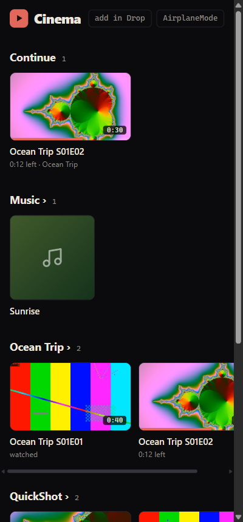
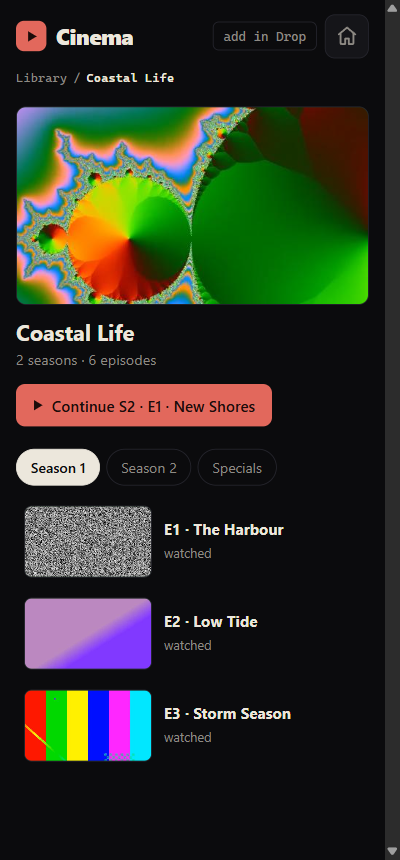
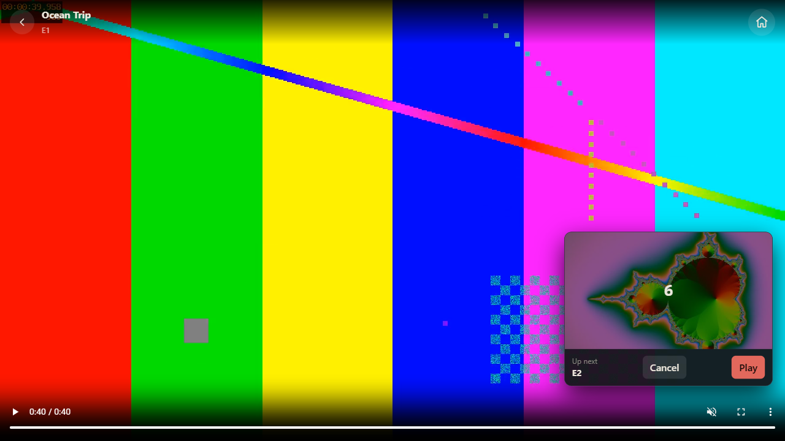

<p align="center"></p>

# Cinema: watch what's on Drop, on every device

An [AirplaneMode](https://github.com/jessewolcott/airplanemode) app. Cinema plays the videos and
music loaded onto [Drop](https://github.com/jessewolcott/airplanemode-drop), on every phone,
tablet and laptop on the hotspot, with no internet.

<p align="center">
  
  
</p>
<p align="center">
  
</p>

<sub>Screenshots from the laptop dev stack; not yet tested on real hardware.</sub>

- **A library from Drop's folders.** Each folder with videos or music becomes a shelf ("Ocean
  Trip", "Kids", "Music"); files sort naturally, so episodes play in order.
- **TV series.** A folder of episodes, or of season folders, becomes a show: one card on the
  home page, a page with season tabs, and episodes labelled from their file names. It plays
  straight on into the next season, and *Continue* shows one card per show (see below).
- **Posters by themselves.** The first browser to show a video grabs a frame from it and gives
  it to the box, so everyone else sees a poster too.
- **Picks up where you left off, per device.** Every tablet on the plane keeps its own place,
  with a *Continue* shelf. No accounts.
- **Up next.** At the end of an episode the next one in the folder starts after a countdown;
  albums just keep playing. Lock-screen controls (Media Session) on phones.
- **Opens from Drop.** Drop shows *Play in Cinema* on any video or audio file this device can
  play (the platform's `apps.json` declares that Cinema opens `video/*` and `audio/*`).
- **Watch together (Sync Watch).** Tap *Watch together* in the player and everyone on the
  hotspot can join from the library's *Watching together* shelf. Every phone plays in step,
  each with its own sound (earbuds on), and anyone can pause, skip or start the next episode
  for everyone. Names and pictures come from the AirplaneMode menu.
- **Respects Drop's "downloads off".** The admin can turn downloads off for a file or folder in
  Drop; Cinema still plays it, and hides the browser's download option.

Cinema never touches the media itself: the browser streams straight from Drop (with seeking),
so Cinema needs very little memory (64 MB). Its only data is the posters.

## TV series

Load a show into Drop either way:

```
Coastal Life/                         Ocean Trip/
  Season 1/                             Ocean.Trip.S01E01.mp4
    Coastal.Life.S01E01.The.Harbour.mp4 Ocean.Trip.S01E02.mp4
    Coastal.Life.S01E02.Low.Tide.mp4
  Season 2/
    Episode 1 - New Shores.mp4
  Specials/
    Behind the Scenes.mp4
```

- **What counts as a show:** a folder with season subfolders ("Season 1", "S2", "Series 3",
  "Specials", or subfolders whose files are named like episodes), or a folder with at least two
  files named like episodes. "Movies/Kids" stays an ordinary shelf.
- **Episode names** understood: `S01E02`, `s1e2`, `1x02`, `Episode 2`, `Ep 2`, `E02`. Whatever
  follows becomes the episode title ("E2 · Low Tide"). The season comes from the folder name,
  then the file name, then the folder's order. Specials go last.
- **Watching:** the show's page has one button, *Play S1 · E1*, *Continue S2 · E4*, or the next
  episode once you finish one. *Up next* carries on into the next season, and the lock-screen
  next/previous buttons follow the whole show.

**What plays** depends on the device's browser. MP4 (H.264 + AAC), WebM and MP3/AAC play
everywhere; MKV, HEVC or AC-3 audio may not. Files a device can't play are dimmed and say so.

## Running it

**On the box:** the platform repo runs the released image at `/cinema/`, next to Drop.

**On its own, for development** (with Drop built from `../airplanemode-drop`):

```
docker compose up -d --build        # Cinema http://localhost:8768, Drop http://localhost:8766
python tests/test_cinema.py         # API tests (CI runs these before building)
node tests/test_series.mjs          # TV-series logic, run straight from the page's code
```

Standalone, Drop is on another port, so the browser treats it as another site and posters
can't be grabbed; everything else works. In the platform's dev stack they share one address.

## Settings

| Variable | Default | Meaning |
|---|---|---|
| `DROP_URL` | `http://drop:8000` | Drop's API, as this container reaches it |
| `DROP_PATH` | `../drop/` | where the browser streams from (relative to `/cinema/`) |
| `ADMIN_URL` | `http://admin:8000` | the admin service, for who's who names in watch parties (empty: off) |
| `CINEMA_POLL_WAIT` | `20` | seconds a watch party's long-poll waits for a change |

## API

| | |
|---|---|
| `GET api/library` | Drop's folders and the video/audio files in them, plus `drop_path` |
| `GET api/posters/{id}` | a poster (JPEG/WebP) |
| `PUT api/posters/{id}` | store one; needs `X-Cinema: 1`, max 300 KB, only for files Drop has |
| `GET api/watch` | open watch parties on this hotspot |
| `GET api/watch/clock` | the box's clock (ms), for each phone's clock offset |
| `POST api/watch` | start a party `{item, pos, playing}` → `{code, token, state}` |
| `POST api/watch/{code}/join` | a seat (or yours back) `{token?}` → `{token, state}` |
| `GET api/watch/{code}/state?since=N` | long-poll; seat token in `X-Seat` |
| `POST api/watch/{code}/act` | `{type: play\|pause\|seek\|item, pos?, item?}` |
| `POST api/watch/{code}/leave` | leave (the last one out ends the party) |

How the phones stay in step: [llm/sync-watch.md](llm/sync-watch.md).

*Not yet tested on real hardware* (watch parties were tried with two browsers on one laptop). Subtitles (`.vtt` next to a video) are a planned addition.
